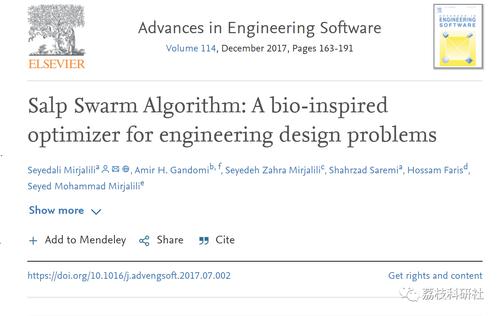
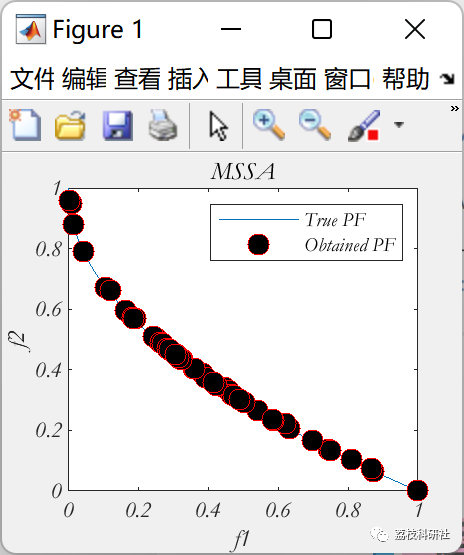
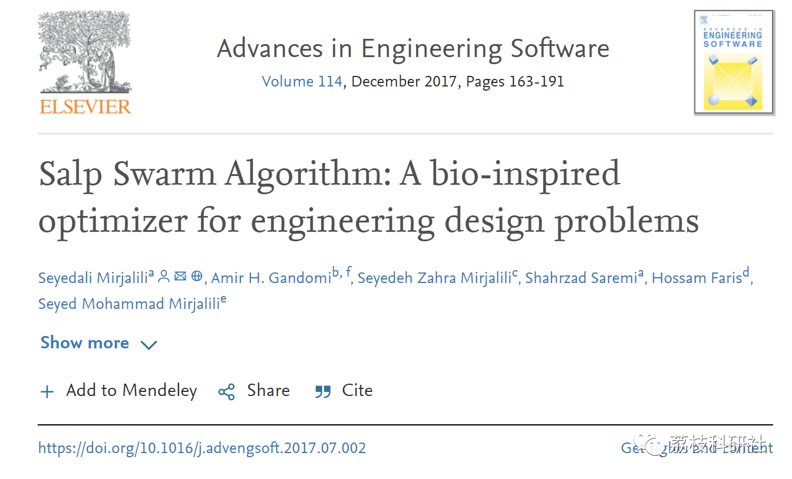

# Multi-objective Perch Optimization Algorithm (Matlab Code Implementation)

💥💥💥💞💞💞 Welcome to this blog❤️❤️❤️💥💥💥
🏆 Bloggers' Advantage: 🌞🌞🌞 The content of the blog strives for rigorous thinking and clear logic to facilitate readers.
⛳️ Mantra: A journey of a thousand miles is begun with a single step.
Litchi Research Society
Code Collection: Electric power systems, intelligent algorithms and their applications, neural network prediction, path planning, optimization dispatching, workshop scheduling, image processing, signal processing...
🎁 Special Section Links:
🌈🌈🌈🌟🌟🌟 Electrical Code Intelligent Algorithms and Their Applications Path Planning Neural Network Prediction Optimization Dispatching Image Processing Workshop Scheduling Signal Processing Romantic Her Thoughts Math Modeling Complete Code Issues
💥1 Overview
📚2 Running Results
🎉3 References
🌈4 MATLAB Code Implementation
​
💥1 Overview
The stingray belongs to the family Stingrayidae, with its body being transparent and tubular. Its tissues are highly similar to those of hydroids. Its movement is also very similar to that of hydroids, where water is pumped into the body as propulsion force for forward movement.
Biological research on this type of creature is at an early milestone mainly because it is difficult to enter their habitat and it is indeed challenging to keep them in laboratory settings. The focus of this paper is on their swarm behavior. In deep seas, stingrays often form a group called the dogfish chain. The main reason for this behavior is not yet clear, but some researchers believe that it is done to achieve better movement through rapid coordination changes and foraging.
There are almost no mathematical models for swarm behavior and stingray populations in the literature. Moreover, there are no mathematical models for salp swarms used to solve optimization problems, while swarms, ants, and fish groups have been widely used for modeling and solving optimization problems. Salp Swarm Algorithm (SSA) mimics salps to solve optimization problems.
📚2 Running Results
🎉3 References
🌈4 MATLAB Code Implementation
Click the article's lower left corner to read more.

## Images

<!-- PAYMENT_BLOCK -->

## Get this dataset

- Payment link (Stripe): [Buy now](https://buy.stripe.com/3cs8yP7sY87d0vu9AB)
- Payment QR code: 

<!-- /PAYMENT_BLOCK -->
